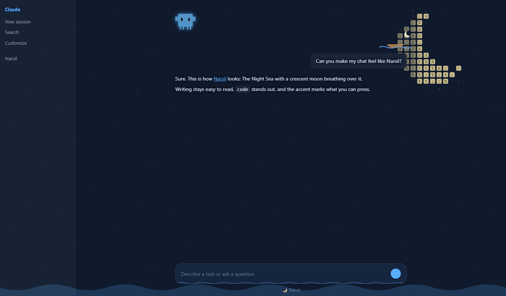
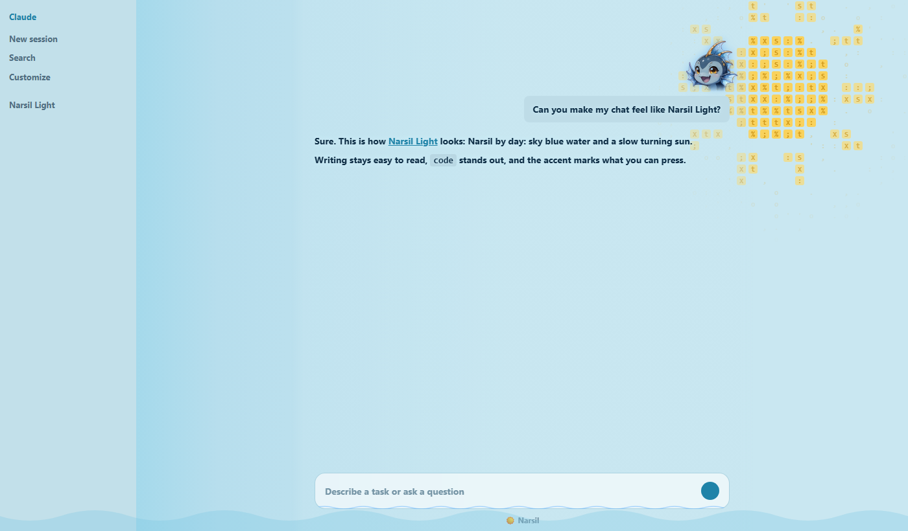

# Narsil Skin

<p align="center">
  
  
</p>

Narsil Skin is the third mod in the [Narsil](https://github.com/davshn/narsil-pet) family, alongside [Narsil Check](https://github.com/davshn/narsil-check): it reskins the Claude desktop app. It applies live color themes and animated wallpapers drawn with characters that move behind the chat, through the app's own theme API. Themes are picked from a side pane with `/narsil-skin themes`, so the space above the prompt stays free for Narsil.

It is a fork of [claude-desktop-themes](https://github.com/0toshigami/claude-desktop-themes), by [0toshigami](https://github.com/0toshigami): all the original work, the design, and the themes are theirs. See [Credits](#credits).

It is an **open source** Claude Code mod, released under the [MIT](#license) license.

## Contents

- [Features](#features)
- [Installation](#installation)
- [Commands](#commands)
- [Supported systems](#supported-systems)
- [Uninstalling](#uninstalling)
- [Security](#security)
- [Development](#development)
- [Credits](#credits)
- [License](#license)

## Features

### The themes pane
`/narsil-skin themes` opens the **Themes** pane next to the chat. At the top it says which theme you have on and its description, and below are the themes grouped into **Live wallpapers**, **Color themes**, and **Your themes**, each with its thumbnail. A click on a theme applies it right away; **Claude** brings back the app's original colors. The pane closes with **Close** or with Escape.

The **Auto day and night** button switches themes on its own based on your computer's clock: **Narsil Light** from 6:00 to 17:59 and **Narsil** from 18:00 to 5:59. Turn it off by clicking it again or by picking a theme by hand.

The theme you pick is kept between sessions, and your other open conversations switch to it at their next message, or within ten seconds.

### Animated wallpapers
A scene drawn with characters moves behind the chat. From the pane you can change its speed and how opaque the app's panels are over it (**panels**), so the text stays readable.

<p align="center">
  
  <br><strong>Narsil</strong>
</p>

**Narsil** is the house theme: a night sea with a crescent moon at the top right, whose light breathes slowly. The stars twinkle, and flare when a turn ends; shooting stars cross while Claude thinks, and a blue border pulses when it is waiting for you.

The wave at the bottom sums up the state of all your conversations at once:

| Wave | When |
|:-|:-|
| **Yellow** | Some conversation needs your answer. |
| **Red** | There was an error. It goes out when a tool works again or you write to that conversation. |
| **Blue** | Nothing is pending. |
| **High tide** | Some conversation is working. |

If one conversation is waiting for you and another has an error at the same time, the wave turns yellow.

<p align="center">
  
  <br><strong>Narsil Light</strong>
</p>

**Narsil Light** is the daytime version for light mode: a sky-blue sky with a sun at the top right, whose rays turn slowly. The wave works the same way, in softer tones so the text over it stays readable, and the sunlight flashes when a turn ends.

While Claude thinks, the scene runs three times faster.

### Color themes
A color theme changes all of the app's colors, built from three: a page color, a text color, and an accent. The mod only includes **Claude**, the app's original colors; you can [make your own](#your-own-themes).

If you have "reduce motion" on, the scenes hold still and only the colors remain.

### Your own themes
Ask Claude to "make me a theme" with an idea, an image, or both. The `make-theme` skill asks you which kind you want, shows you a draft as an Artifact for you to approve, and then builds it.

You can also create them by hand in `%USERPROFILE%\.claude\narsil-skin\` (macOS: `~/.claude/narsil-skin/`):

- **Color theme**: `<id>.json` with `id`, `name`, and the `bg`, `text`, and `accent` colors as `#rrggbb`.
- **Animated wallpaper**: the same `<id>.json`, with the scene as an SVG in `<id>.svg` beside it. It shows up when you pick it in `/narsil-skin themes`, without restarting.

They appear under **Your themes**, and a mod update does not delete them.

## Installation

You need the Claude desktop app, in the **Code** tab. Inside Claude Code, run:

```
/plugin marketplace add davshn/narsil-skin
/plugin install narsil-skin@narsil-skin
```

In the desktop app, where `/plugin` does not work: open **Settings → Plugins**, click **Add → Add marketplace**, type `davshn/narsil-skin`, and install **narsil-skin**.

Then:

1. If `/narsil-skin` does not show up in the command list, run `/reload-plugins` and then `/reload-skills`.
2. Run `/narsil-skin themes` in a conversation and pick a theme. On the **+ New** home page it only opens a new conversation: run it again inside that one.

There is nothing else to install: the themes paint through the app's own theme API, with no restart.

### Coming from 1.x

Versions 1.x painted the themes with an extension that Claude Desktop 6.28899 and later no longer loads. If it is still installed, the themes pane says so: click **Remove old extension** to take it out, along with the `REACT_PROFILE` variable when no other mod uses its folder. Your theme choice carries over. Custom stylesheets (`<id>.css`) and canvas scenes (`<id>.js`) of your own themes are no longer read: their colors still work, and a scene can be redrawn as `<id>.svg`.

To update to the latest version:

```
/plugin marketplace update narsil-skin
/plugin update narsil-skin@narsil-skin
```

## Commands

| Command | What it does |
| --- | --- |
| `/narsil-skin themes` | Opens the themes pane. It is the way to open it again if you close it. |
| `/narsil-skin` | Shows the help with the commands. It also answers this way to an argument it does not know. |
| `/narsil-skin:make-theme` | Creates a new theme, a color one or an animated wallpaper, from an idea or an image. You can also ask Claude for it in your own words. |

## Supported systems

The themes are painted by the apps that draw Claude Code's themes:

| | Desktop app | Mobile app | Terminal and VS Code |
| --- | --- | --- | --- |
| Themes pane | Yes | Yes | The pane is drawn, but there is nothing to paint |
| Color themes | Yes | Yes | No |
| Animated wallpapers | Yes | Yes, under one veil | No |

It uses the theme API that Claude Code gives mods, from version 2.1.328.

## Uninstalling

1. Pick **Claude** in `/narsil-skin themes` to bring back the app's colors (uninstalling also takes the theme with it).
2. Uninstall the plugin: in **Settings → Plugins** or with `claude plugin uninstall narsil-skin`.
3. Optional: also remove the marketplace, with `claude plugin marketplace remove narsil-skin` or from **Settings → Plugins → Add → Manage marketplaces**.

Your themes, and the conversations' shared state in `.state`, stay in `%USERPROFILE%\.claude\narsil-skin\` (macOS: `~/.claude/narsil-skin/`). Delete that folder if you do not want them.

If a 1.x extension is still in the app's `extensions` folder, click **Remove old extension** in the themes pane before uninstalling, or remove it by hand. The folder may hold other mods, so this only deletes it, along with the variable, when it contains only this one. In PowerShell:

```powershell
$data = Get-ChildItem "$env:LOCALAPPDATA\Claude-Data" -Directory -Filter 'claude*' -ErrorAction SilentlyContinue |
  Where-Object { Test-Path (Join-Path $_.FullName 'Local State') } | Select-Object -First 1
$d = if ($data) { Join-Path $data.FullName 'extensions\fmkadmapgofadopljbjfkapdkoienihi' } else { "$env:APPDATA\Claude\extensions\fmkadmapgofadopljbjfkapdkoienihi" }
if (((Get-Content "$d\manifest.json" -Raw | ConvertFrom-Json).content_scripts.js -join ',') -eq 'theme.js') {
  Remove-Item -Recurse $d; [Environment]::SetEnvironmentVariable('REACT_PROFILE', $null, 'User')
} else { "Another mod shares $d. Delete only theme.js, theme.json and event.json, and their manifest entries." }
```

On macOS, in Terminal:

```bash
d="$HOME/Library/Application Support/Claude/extensions/fmkadmapgofadopljbjfkapdkoienihi"
js() { plutil -extract "$1" raw -o - "$d/manifest.json" 2>/dev/null; }
if [ "$(js content_scripts)/$(js content_scripts.0.js)/$(js content_scripts.0.js.0)" = "1/1/theme.js" ]; then
  rm -rf "$d"; launchctl unsetenv REACT_PROFILE
  rm -f ~/Library/LaunchAgents/com.github.0toshigami.themes-for-claude.plist
else echo "Another mod shares $d. Delete only theme.js, theme.json and event.json, and their manifest entries."; fi
```

## Security

A theme is data only. Its colors go to the app through the theme API, and an animated wallpaper's scene (`<id>.svg`) is drawn by the app as a pure vector picture: it refuses any scene that holds a script, a picture, a font, or a link to anything outside it.

## Development

Narsil Skin is open source and contributions are welcome: open an issue or a pull request on [GitHub](https://github.com/davshn/narsil-skin). Improvements that help everyone are also welcome in the [original project](https://github.com/0toshigami/claude-desktop-themes).

To work on a local copy, add its folder as a marketplace; changes arrive with `/reload-plugins`, without reinstalling:

```
claude plugin marketplace add <path-to-your-copy>
claude plugin validate .
claude plugin test .
```

- `hooks/register.tsx`: the mod's hooks (the themes pane, `/narsil-skin themes`, setting the theme, the Backdrop scene, the reactions to what Claude is doing, and removing the 1.x extension).
- `hooks/look.ts`: the themes' palettes and the colors built from them with `make-colors.js`, which comes from the plugin-authoring skill and is left as it is.
- `hooks/scenes.ts`: the animated wallpapers, as SVG scenes.
- `hooks/themes.ts`: the list of themes, reading your themes, and the pane's thumbnails.
- `hooks/thumbs.ts`: the animated wallpapers' thumbnails.
- `skills/make-theme/`: the skill that creates new themes.
- `tools/thumbs/`: the thumbnail capture.
- `tests/`: the tests.

## Credits

Narsil Skin is a fork of [claude-desktop-themes](https://github.com/0toshigami/claude-desktop-themes), created by [0toshigami](https://github.com/0toshigami). The themes, the animated wallpapers, the original extension, and the `make-theme` skill are their work. This fork is maintained by [davshn](https://github.com/davshn), who moved the theme picker to a side pane to keep the space above the prompt free.

Thanks also to [@handsher_NGU](https://x.com/handsher_NGU/status/2115618341675319417/video/1), whose post gave the idea for the original mod.

It is a community mod: it is not made or endorsed by Anthropic. Claude, Claude Desktop, Claude Code, and Clawd belong to Anthropic.

## License

Narsil Skin is released under the [MIT license](LICENSE), the same as the original project, whose copyright notice is kept in [LICENSE](LICENSE).

In short: you can use, copy, modify, and distribute it freely, including in closed-source projects, as long as you keep the copyright notice and the license text. It comes with no warranty.

Copyright © 2026 0toshigami
