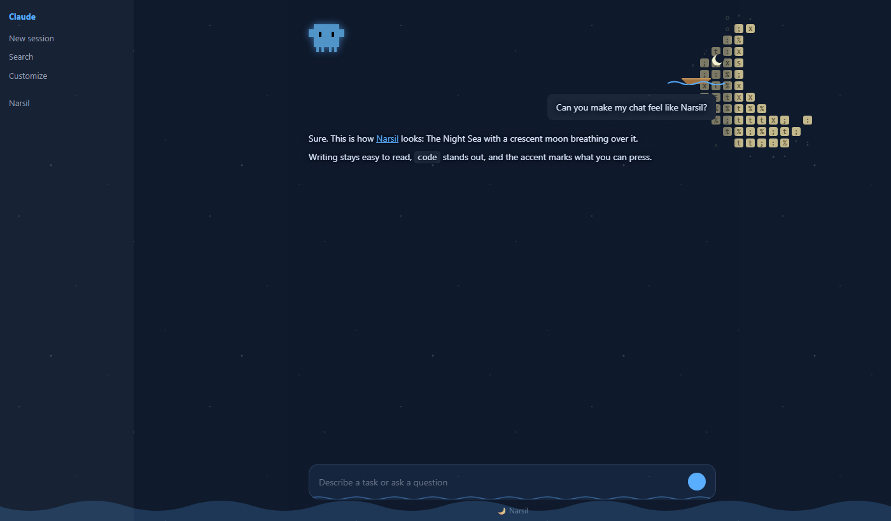
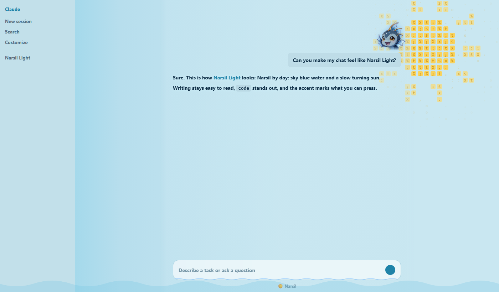

# Narsil Skin

<p align="center">
  
  
</p>

Narsil Skin es el tercer mod de la familia de [Narsil](https://github.com/davshn/narsil-pet), junto a [Narsil Check](https://github.com/davshn/narsil-check): le cambia la piel a la app de escritorio de Claude. Aplica temas de color en vivo (colores, fuentes, esquinas y sombras) y fondos animados dibujados con caracteres que se mueven detrás del chat. Los temas se eligen desde un panel lateral con `/narsil-skin themes`, así que el espacio encima del prompt queda libre para Narsil.

Es un *fork* de [claude-desktop-themes](https://github.com/0toshigami/claude-desktop-themes), de [0toshigami](https://github.com/0toshigami): todo el trabajo original, el diseño y los temas son suyos. Consulta [Créditos](#créditos).

Es un mod de Claude Code de **código abierto**, publicado bajo la licencia [MIT](#licencia).

## Índice

- [Funcionalidades](#funcionalidades)
- [Instalación](#instalación)
- [Comandos](#comandos)
- [Sistemas compatibles](#sistemas-compatibles)
- [Desinstalación](#desinstalación)
- [Seguridad](#seguridad)
- [Desarrollo](#desarrollo)
- [Créditos](#créditos)
- [Licencia](#licencia)

## Funcionalidades

### El panel de temas
`/narsil-skin themes` abre el panel **Themes** al lado del chat. Arriba dice qué tema llevas puesto y su descripción, y debajo están los temas agrupados en **Live wallpapers** (fondos animados), **Color themes** (temas de color) y **Your themes** (tus temas), cada uno con su miniatura. Un clic en un tema lo aplica al momento; **Claude** devuelve los colores originales de la app. El panel se cierra con **Close** o con Escape.

El botón **Auto day and night** cambia de tema solo según la hora de tu equipo: **Narsil Light** de 6:00 a 17:59 y **Narsil** de 18:00 a 5:59. Se apaga pulsándolo otra vez o eligiendo un tema a mano.

La primera vez el panel solo muestra el botón **Install extension**: es el paso que instala lo que pinta los temas (consulta [Instalación](#instalación)).

### Fondos animados
Una escena dibujada con caracteres se mueve detrás del chat. Desde el panel puedes cambiar su movimiento (suave o celda a celda), su velocidad, el tamaño de las celdas y la opacidad del fondo que hay detrás del texto para que se lea bien.

<p align="center">
  
  <br><strong>Narsil</strong>
</p>

**Narsil** es el tema de la casa: un mar nocturno con una luna creciente arriba a la derecha, cuya luz respira despacio. La luna es lo único de la escena que se anima. Las estrellas destellan al terminar el turno, cruzan estrellas fugaces mientras Claude piensa y late un borde azul cuando te espera.

La ola de abajo resume el estado de todas tus conversaciones a la vez:

| Ola | Cuándo |
|:-|:-|
| **Amarilla** | Alguna conversación necesita tu respuesta. |
| **Roja** | Hubo un error. Se apaga cuando una herramienta vuelve a funcionar o le escribes a esa conversación. |
| **Azul** | No hay nada pendiente. |
| **Marea alta** | Alguna conversación está trabajando. |

Si a la vez hay una conversación esperándote y un error en otra, la ola se pone amarilla.

<p align="center">
  
  <br><strong>Narsil Light</strong>
</p>

**Narsil Light** es la versión de día para el modo claro: un cielo celeste con un sol arriba a la derecha, cuyos rayos giran despacio, y todo el texto en negrita. La ola funciona igual, en tonos más suaves para que se lean las letras que quedan debajo, y al terminar el turno destella la luz del sol.

Mientras Claude piensa, la escena va tres veces más rápido.

### Temas de color
Un tema de color cambia los colores, las fuentes, la forma de las esquinas y las sombras, y puede reaccionar a lo que hace Claude. El mod solo incluye **Claude**, los colores originales de la app; puedes [crear los tuyos](#tus-propios-temas).

Si tienes activado "reducir movimiento", las animaciones se apagan y solo quedan los cambios de color.

### Tus propios temas
Pídele a Claude "hazme un tema" con una idea, una imagen o las dos. La skill `make-theme` te pregunta qué tipo quieres, te enseña un borrador como Artifact para que lo apruebes y después lo construye.

También puedes crearlos a mano en `%USERPROFILE%\.claude\narsil-skin\` (macOS: `~/.claude/narsil-skin/`):

- **Tema de color**: `<id>.json`, con un `<id>.css` opcional.
- **Fondo animado**: `<id>.json` con `"wallpaper": "<id>"` y la escena en `<id>.js`. Aparece al elegirlo en `/narsil-skin themes`, sin reiniciar.

Salen en **Your themes** y una actualización del mod no los borra.

## Instalación

Necesitas la app de escritorio de Claude, en la pestaña **Code**. Dentro de Claude Code, ejecuta:

```
/plugin marketplace add davshn/narsil-skin
/plugin install narsil-skin@narsil-skin
```

En la app de escritorio, donde `/plugin` no funciona: abre **Settings → Plugins**, pulsa **Add → Add marketplace**, escribe `davshn/narsil-skin` e instala **narsil-skin**.

Después:

1. Si `/narsil-skin` no sale en la lista de comandos, ejecuta `/reload-plugins` y luego `/reload-skills`.
2. Ejecuta `/narsil-skin themes` en una conversación. En la página de inicio de **+ New** solo abre una conversación nueva: vuelve a ejecutarlo dentro de ella.
3. Pulsa **Install extension**. Copia la extensión que pinta los temas en la carpeta `extensions` de la app y define `REACT_PROFILE=1`, que hace que la app la cargue:
   - **Windows**: la carpeta es `%LOCALAPPDATA%\Claude-Data\claude_<id>\extensions` en las instalaciones recientes (la de la Microsoft Store, entre ellas) y `%APPDATA%\Claude\extensions` en las demás. La variable se define para tu usuario.
   - **macOS**: la carpeta es `~/Library/Application Support/Claude/extensions`. La variable se define con `launchctl setenv` y un LaunchAgent (`~/Library/LaunchAgents/com.github.0toshigami.themes-for-claude.plist`) la vuelve a definir en cada inicio de sesión.
4. Cierra la app del todo (en Windows, también desde la bandeja del sistema; en macOS, con Cmd+Q) y ábrela otra vez.
5. Ejecuta `/narsil-skin themes` y elige un tema.

Para actualizarlo a la última versión:

```
/plugin marketplace update narsil-skin
/plugin update narsil-skin@narsil-skin
```

## Comandos

| Comando | Qué hace |
| --- | --- |
| `/narsil-skin themes` | Abre el panel de temas. Es la forma de volver a abrirlo si lo cierras. |
| `/narsil-skin` | Muestra la ayuda con los comandos. También responde así a un argumento que no conoce. |
| `/narsil-skin:make-theme` | Crea un tema nuevo, de color o un fondo animado, a partir de una idea o una imagen. También puedes pedírselo a Claude con tus palabras. |

## Sistemas compatibles

Los temas los pinta una extensión dentro de la app de escritorio, así que solo se ven allí:

| | App de escritorio | Terminal, VS Code y app móvil |
| --- | --- | --- |
| Panel de temas | Sí | El panel se dibuja, pero no hay nada que pintar |
| Temas de color y fondos animados | Sí, en Windows y macOS | No |
| Linux | Todavía no | No |

No es una función oficial de la app: se apoya en los mods y las extensiones que la app ya tiene, así que una actualización de la app puede romperlo.

## Desinstalación

Desinstalar el plugin solo quita sus comandos. La extensión de la carpeta `extensions` se queda, así que quítala primero:

1. Ejecuta `/narsil-skin themes` y pulsa **Remove extension**. Quita los archivos y las entradas del mod de `fmkadmapgofadopljbjfkapdkoienihi`, en la carpeta `extensions` de la app. Si ningún otro mod usa esa carpeta, también la borra junto con la variable `REACT_PROFILE` (y en macOS, el LaunchAgent). Si otro mod la usa, deja las dos.
2. Reinicia la app.
3. Desinstala el plugin: en **Settings → Plugins** o con `claude plugin uninstall narsil-skin`.
4. Opcional: quita también el marketplace, con `claude plugin marketplace remove narsil-skin` o desde **Settings → Plugins → Add → Manage marketplaces**.

Tus temas de `%USERPROFILE%\.claude\narsil-skin\` (macOS: `~/.claude/narsil-skin/`) se quedan. Borra esa carpeta si no los quieres.

Si desinstalaste el plugin primero, quita la extensión a mano. La carpeta puede tener otros mods, así que esto solo la borra, junto con la variable, cuando contiene únicamente este. En PowerShell:

```powershell
$data = Get-ChildItem "$env:LOCALAPPDATA\Claude-Data" -Directory -Filter 'claude*' -ErrorAction SilentlyContinue |
  Where-Object { Test-Path (Join-Path $_.FullName 'Local State') } | Select-Object -First 1
$d = if ($data) { Join-Path $data.FullName 'extensions\fmkadmapgofadopljbjfkapdkoienihi' } else { "$env:APPDATA\Claude\extensions\fmkadmapgofadopljbjfkapdkoienihi" }
if (((Get-Content "$d\manifest.json" -Raw | ConvertFrom-Json).content_scripts.js -join ',') -eq 'theme.js') {
  Remove-Item -Recurse $d; [Environment]::SetEnvironmentVariable('REACT_PROFILE', $null, 'User')
} else { "Another mod shares $d. Delete only theme.js, theme.json and event.json, and their manifest entries." }
```

En macOS, en la Terminal:

```bash
d="$HOME/Library/Application Support/Claude/extensions/fmkadmapgofadopljbjfkapdkoienihi"
js() { plutil -extract "$1" raw -o - "$d/manifest.json" 2>/dev/null; }
if [ "$(js content_scripts)/$(js content_scripts.0.js)/$(js content_scripts.0.js.0)" = "1/1/theme.js" ]; then
  rm -rf "$d"; launchctl unsetenv REACT_PROFILE
  rm -f ~/Library/LaunchAgents/com.github.0toshigami.themes-for-claude.plist
else echo "Another mod shares $d. Delete only theme.js, theme.json and event.json, and their manifest entries."; fi
```

## Seguridad

La hoja de estilos de un tema se aplica a tu página de Claude con la sesión iniciada, así que la extensión rechaza cualquier hoja que cargue algo de fuera: nada de `@import` ni de `url()`, salvo `data:`. El `.json` y el `.css` de un tema son solo datos.

La escena de un fondo animado (`<id>.js`) es código y se ejecuta en tu página de Claude con la sesión iniciada. Guarda solo escenas que hayas hecho tú o en las que confíes, como con cualquier otro código.

## Desarrollo

Narsil Skin es de código abierto y las contribuciones son bienvenidas: abre un *issue* o un *pull request* en [GitHub](https://github.com/davshn/narsil-skin). Las mejoras que sirvan a todos se agradecen también en el [proyecto original](https://github.com/0toshigami/claude-desktop-themes).

Para trabajar sobre una copia local, añade su carpeta como marketplace; los cambios llegan con `/reload-plugins`, sin reinstalar:

```
claude plugin marketplace add <ruta-a-tu-copia>
claude plugin validate .
claude plugin test .
```

- `hooks/register.tsx`: los hooks del mod (el panel de temas, `/narsil-skin themes`, instalar y quitar la extensión, y las reacciones a lo que hace Claude).
- `hooks/themes.ts`: la lista de temas, la lectura de tus temas y las miniaturas del panel.
- `hooks/thumbs.ts`: las miniaturas de los fondos animados.
- `extension/`: la extensión que pinta los temas dentro de la app (`core.js`, `engine.js` y las escenas de `extension/src/scenes/`).
- `themes/`: las hojas de estilos de los temas de color, con la base común en `_base.css` y `_wallpaper.css`.
- `skills/make-theme/`: la skill que crea temas nuevos.
- `tools/`: el montaje de la extensión y la captura de las miniaturas.
- `tests/`: los tests.

## Créditos

Narsil Skin es un *fork* de [claude-desktop-themes](https://github.com/0toshigami/claude-desktop-themes), creado por [0toshigami](https://github.com/0toshigami). Los temas, los fondos animados, la extensión y la skill `make-theme` son obra suya. Este fork lo mantiene [davshn](https://github.com/davshn), que cambió el selector de temas a un panel lateral para dejar libre el espacio encima del prompt.

Gracias también a [@handsher_NGU](https://x.com/handsher_NGU/status/2115618341675319417/video/1), cuya publicación dio la idea del mod original.

Es un mod de la comunidad: no lo ha hecho ni lo respalda Anthropic. Claude, Claude Desktop, Claude Code y Clawd son de Anthropic.

## Licencia

Narsil Skin se publica bajo la [licencia MIT](LICENSE), la misma del proyecto original, cuyo aviso de copyright se conserva en [LICENSE](LICENSE).

En resumen: puedes usarlo, copiarlo, modificarlo y distribuirlo libremente, también en proyectos cerrados, siempre que mantengas el aviso de copyright y el texto de la licencia. Se distribuye sin ninguna garantía.

Copyright © 2026 0toshigami
